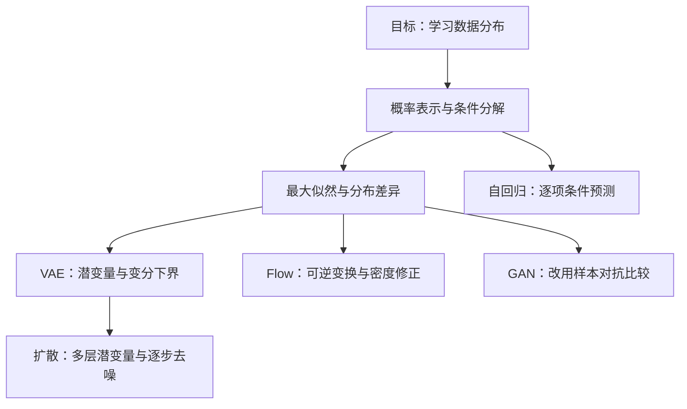

# 生成式人工智能：从概率建模到扩散模型

一套从课程课件提炼的中文学习笔记，围绕同一个问题展开：**怎样从有限样本学习数据分布，并生成新的数据？**

首页用于选路；各主题独立成章，先讲直觉与关键结论，再给出公式、适用条件和训练流程。较长推导可以按需展开。内容覆盖本地 `temp/` 的第 0–11 讲，共 13 份 PDF（含自回归课件的两个版本）。

## 从哪里开始？

- **第一次系统学习**：按下表 01 → 08 阅读；遇到符号先查[符号约定](docs/notation.md)。
- **已有概率与深度学习基础**：从 [03 自回归](docs/03-autoregressive-models.md)与 [04 最大似然](docs/04-maximum-likelihood.md)进入，再比较各模型族。
- **复习或定位公式**：使用[核心公式速查](docs/formula-sheet.md)，再回到对应章节查看条件和推导。
- **回查原文**：使用[课件来源、覆盖范围与勘误](docs/sources.md)。章节按知识主题编排，与原讲次的对应也在该页。

## 知识目录

| 章节 | 要回答的问题 | 核心内容 |
| --- | --- | --- |
| [01 · 生成建模导论](docs/01-introduction.md) | 生成模型到底学什么？ | 分布、采样、似然、表征与任务边界 |
| [02 · 概率建模](docs/02-probabilistic-modeling.md) | 高维联合分布怎样表示？ | 维度灾难、条件独立、贝叶斯网络、生成式与判别式 |
| [03 · 自回归模型](docs/03-autoregressive-models.md) | 怎样用“下一步预测”生成数据？ | 链式分解、NADE/MADE、因果架构、训练与生成 |
| [04 · 最大似然与泛化](docs/04-maximum-likelihood.md) | 学习目标从哪里来？ | KL、MLE、交叉熵、梯度优化、有限样本与过拟合 |
| [05 · 潜变量模型与 VAE](docs/05-latent-variable-models-and-vae.md) | 潜变量难以积分时怎么办？ | GMM、重要性采样、ELBO、重参数化、β-VAE、VQ-VAE |
| [06 · 归一化流](docs/06-normalizing-flows.md) | 可逆变换怎样得到可计算的密度？ | 换元公式、Jacobian、NICE/Real NVP、MAF/IAF、蒸馏 |
| [07 · 生成对抗网络](docs/07-generative-adversarial-networks.md) | 不计算似然，能否学习生成？ | 对抗目标、JS、模式坍塌、WGAN、图像翻译与 StyleGAN |
| [08 · 扩散模型](docs/08-diffusion-models.md) | 怎样把生成分成简单的去噪步骤？ | DDPM、前向后验、变分目标、噪声预测、训练与采样 |

## 这些知识如何连起来？

箭头表示阅读与概念联系，并非互斥分类。自回归网络也可以构造 Flow 或 VQ token 的先验；对抗损失可以用于自编码器；DDPM 则与层次 VAE 共享变分视角。

## 五类模型先看这张表

| 模型族 | 如何表示分布？ | 典型训练方式 | 生成时的主要代价 |
| --- | --- | --- | --- |
| 自回归 | 条件概率的乘积，可计算模型似然 | 最大似然 / 交叉熵 | 通常需要按位置顺序采样 |
| VAE | 对潜变量积分，边缘似然通常难算 | 最大化 ELBO | 先采样潜变量，再解码 |
| Flow | 同维可逆变换，用 Jacobian 修正密度 | 可计算密度下的最大似然 | 多层变换；速度依架构方向而异 |
| GAN | 生成器诱导隐式分布，通常不直接提供密度 | 交替优化生成器与判别器 / critic | 常可用一次生成器前向得到样本 |
| DDPM | 含噪状态组成的反向马尔可夫链 | 变分目标及其噪声预测简化 | 需要多步调用去噪网络 |

“似然可计算”不保证样本最好看，“样本逼真”也不保证模式覆盖完整。比较模型时，应同时检查**建模假设、学习目标、采样成本和实际评价需求**。

## 阅读约定

- 每章以三个要点开场，以自检问题收尾；公式速查仅用于复习，不能替代正文中的条件。
- 数学记号统一：$N$ 是样本数、$n$ 是数据维数，$p_{\mathrm{data}}$ 是真实分布；高斯分布第二参数统一为方差或协方差。
- 公式使用 Markdown 数学语法，关系图使用 Mermaid，可在支持二者的 Markdown 阅读器或 GitHub 中阅读。
- 原课件的重复回顾与动画推导页已合并；少量符号错误和必要的成立条件见[勘误说明](docs/sources.md)。原始课件保留在本地 `temp/`，其链接在本地可用，知识正文可独立阅读。

资料来源：课程 *Generative Models & AI4S Applications*，刘云帆。本仓库为学习整理；[完整来源与延伸阅读](docs/sources.md)。
