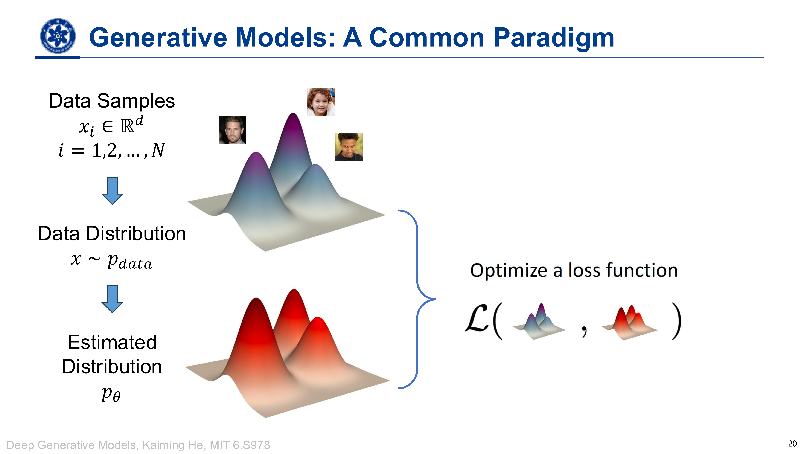

# 生成式人工智能

## 引言

### 生成式人工智能时代

- Coding Agent
- Text-to-image generation: Stable Diffusion
- Text-to-image generation: Seedance
- AI for Science: Protein Design
- AI for Science: Weather Forecasting

### 生成式人工智能时代演进

- Progression of Synthetic Face Quality
- PatchMatch – Content-aware Fill in Photoshop (SIGGRAPH, 2009)
- Texture Synthesis Efros-Leung Algorithm (ICCV, 1999)

---

- "What I cannot create, I do not understand." - Feynman
- "What I understand, I can create" - Generative Artificial Intelligence

### A Toy Example: Scalar Generation(标量生成)

1.要生成什么？  
只考虑一个数：学生的体重 $x$，所以叫 Scalar Generation（标量生成）。真实体重服从某个未知分布 $p_{\text{data}}(x)$。假设，可以用一个高斯分布近似它：
$$
p_{\theta}(x) = \mathcal{N}(x;\mu, \sigma^2) \approx p_{\text{data}}(x)
$$
这里需要学习的参数就是 $\theta = (\mu, \sigma^2)$: 平均体重和体重的离散程度。

2.怎么学？  
收集真实学生的体重 $x_1,\ldots,x_N$，再做概率密度估计，找到合适的 $\mu$ 和 $\sigma^2$。

体重只是一个数，复杂数据可能有成千上万个维度，但核心目标仍然是学习 $p_\theta(x)\approx p_{\text{data}}(x)$。

### 生成模型的一种常见范式

### 与常见模型对比

#### 与判别模型比较

- **判别模型**：输入图片 $x$，判断标签 $y$，例如“这是一只狗”，学习的是 $p(y\mid x)$。
- **生成模型**：给定标签 $y$，生成对应的数据 $x$，例如根据“狗”生成图片，学习的是 $p(x\mid y)$。

生成任务具有**多样性、开放性和复杂性**：同一个条件可以有很多合理结果，没有唯一标准答案，输出也可能比输入复杂得多。  
生成模型还可以通过**贝叶斯公式**用于分类等判别任务。

#### 与图形学模型比较

- **传统图形学**：人为指定物体形状、颜色、位置等参数，再按照明确规则渲染图片。
- **统计生成模型**：从大量真实数据中学习规律，再生成新数据，适合人脸等难以手工写清生成规则的内容。

两者都用到先验知识，只是侧重不同：图形学更依赖明确的规则，统计生成模型更依赖数据。

### 生成模型的挑战

- **Challenge 1:** Data dimension $d$ can be extremely high ($d \gg N$)
    - Need compact representations of data samples
    - Using deep neural network is one of the solutions
- **Challenge 2:** Data distribution $p_{data}$ can be extremely complex
    - Decompose $p_data$ into simple, tractable components
    - Learn these components with deep neural networks
- **Challenge 3:** Proper evaluation of the gap $\mathcal{p_{data}, p_{\theta}}$