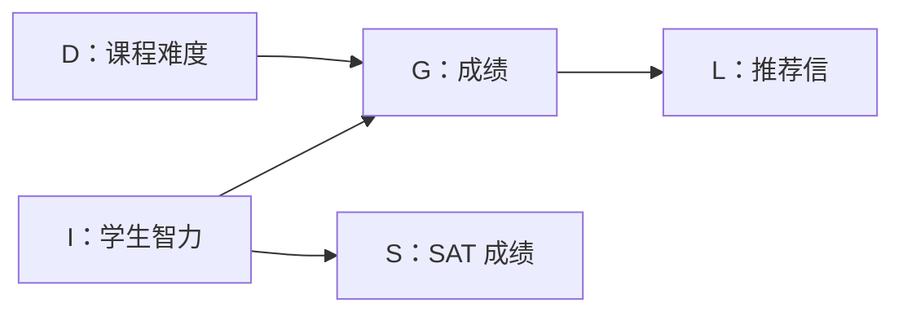

# 02 · 概率建模：从联合分布到结构化表示

[返回首页](../README.md) · [符号约定](notation.md)

> 用分解结构与有限参数的函数，表示高维数据的概率依赖。

## 先抓住这几件事

- 链式法则总能分解联合分布，**但不自动减少参数**。
- 条件独立能缩小条件集合，以表达能力换取计算与统计效率。
- 贝叶斯网络描述概率依赖结构；神经网络可以参数化其中的条件分布，两者可以结合。

## 1. 概率学习的三个组成

| 组成 | 要回答的问题 |
| --- | --- |
| 模型族 $\{p_\theta\}$ | 能表示哪些分布？ |
| 学习准则 $\mathcal{L}(x;\theta)$ | 怎样评价与数据的匹配程度？ |
| 优化算法 | 怎样求得合适参数？ |

总体目标常写为：

$$
\theta^*=\arg\min_\theta
\mathbb{E}_{x\sim p_{\mathrm{data}}}[\mathcal{L}(x;\theta)].
$$

真实分布未知，实践中用训练样本平均近似期望。本章先解决模型如何表示；学习准则见[最大似然](04-maximum-likelihood.md)。

## 2. 直接表示联合分布的代价

伯努利变量满足 $P(X=1)=p$、$P(X=0)=1-p$；$m$ 类变量满足 $P(Y=i)=p_i$、$\sum_i p_i=1$。由于归一化约束，$m$ 个概率值只有 $m-1$ 个**自由参数**。

| 对象 | 可能状态数 | 任意分布的自由参数数目 |
| --- | --- | --- |
| 伯努利变量 | $2$ | $1$ |
| $m$ 类变量 | $m$ | $m-1$ |
| RGB 像素，每通道 256 个取值 | $256^3$ | $256^3-1$ |
| $n$ 个二元变量 | $2^n$ | $2^n-1$ |
| $n$ 个变量，每个有 $m$ 个取值 | $m^n$ | $m^n-1$ |

一张 $28\times28$ 二值图像有 $2^{784}$ 种状态。若逐一存储概率，不仅存储量巨大，有限数据也无法可靠估计所有参数。这是维度灾难的一种表现。

## 3. 三种分解，三种表达能力

### 完整链式分解

对固定变量顺序，链式法则给出：

$$
p(x_1,\ldots,x_n)=\prod_{i=1}^{n}p(x_i\mid x_{<i}),
\qquad x_{<i}=(x_1,\ldots,x_{i-1}).
$$

第一项为 $p(x_1)$。这不要求独立性；对二元变量，完整条件概率表仍需 $\sum_{i=1}^{n}2^{i-1}=2^n-1$ 个参数。

### 完全独立

$$
p(x_1,\ldots,x_n)=\prod_{i=1}^{n}p(x_i).
$$

二元情形仅需 $n$ 个参数，但无法刻画像素之间的相关结构。**状态数仍然是 $2^n$**，减少的是模型的自由度。

### 条件独立与一阶马尔可夫链

给定 $Z$ 后，若 $p(x,y\mid z)=p(x\mid z)p(y\mid z)$，则记作 $X\perp Y\mid Z$。这里考虑条件概率有定义的取值；连续情形使用条件密度。

一阶马尔可夫假设施加：

$$
X_{i+1}\perp(X_1,\ldots,X_{i-1})\mid X_i,
\qquad
p(x_1,\ldots,x_n)=p(x_1)\prod_{i=2}^{n}p(x_i\mid x_{i-1}).
$$

| 模型 | 二元情形参数数目 | 保留的结构 |
| --- | --- | --- |
| 完整联合表或链式条件表 | $2^n-1$ | 任意依赖 |
| 一阶马尔可夫链 | $1+2(n-1)=2n-1$ | 最近一个变量提供条件信息 |
| 完全独立 | $n$ | 不表示变量间依赖 |

上述计数假定各位置不共享参数。条件独立不等同于边缘独立；错误的独立性假设会限制模型表达真实分布的能力。

## 4. 贝叶斯网络把假设画成图

贝叶斯网络由有向无环图（DAG）与节点条件分布组成。令 $\operatorname{Pa}(i)$ 是节点 $i$ 的**直接父节点集合**，则：

$$
p(x_1,\ldots,x_n)=\prod_{i=1}^{n}p(x_i\mid x_{\operatorname{Pa}(i)}).
$$

无父节点时使用先验分布。只要每个局部条件分布合法且图无环，按拓扑顺序即可定义归一化的联合分布并依次采样。图记录概率依赖假设，单凭箭头不能断定因果关系。

对于离散变量，条件分布可表示为条件概率表（CPT）。若 $X_i$ 有 $r_i$ 个取值，则其完整 CPT 的自由参数数目为：

$$
(r_i-1)\prod_{j\in\operatorname{Pa}(i)}r_j.
$$

二元变量、最多 $k$ 个父节点时，总参数量不超过 $n2^k$。因此，真正降低成本的是**局部条件集合较小**，而不是 DAG 这个名称本身。

### 例子：难度、智力、成绩与推荐信

$$
p(d,i,g,s,l)=p(d)p(i)p(g\mid i,d)p(s\mid i)p(l\mid g).
$$

该模型包括 $D\perp I$、$S\perp(D,G)\mid I$、$L\perp(D,I,S)\mid G$ 等假设。例如，给定成绩后，其他变量不再为推荐信提供额外信息。

课件中 $G$ 有三个取值，其余变量均为二元变量。完整联合表有 $47$ 个自由参数，上述网络仅需 $1+1+8+2+3=15$ 个。先采样 $D,I$，再采样 $G,S$，最后采样 $L$，就能产生一个完整样本。

## 5. 生成式分类与判别式分类

### 朴素贝叶斯：建模联合，再推导后验

设邮件类别为 $Y$，$X_i\in\{0,1\}$ 表示词是否出现。伯努利朴素贝叶斯假设所有词特征在给定类别后相互独立：

$$
p(y,x)=p(y)\prod_i p(x_i\mid y),\qquad
p(y\mid x)=\frac{p(y)\prod_i p(x_i\mid y)}
{\sum_{y'}p(y')\prod_i p(x_i\mid y')}.
$$

若只比较最可能类别，分母可约去。模型同时描述了 $p(x\mid y)$，因此也可以在给定类别时生成词特征向量。

### 逻辑回归：直接建模类别后验

$$
p_\theta(Y=1\mid x)=\sigma(b+w^\top x),\qquad
\sigma(a)=\frac{1}{1+e^{-a}}.
$$

它不假设输入特征独立，而是把**后验对数几率**设为线性函数：

$$
\log\frac{p_\theta(Y=1\mid x)}{p_\theta(Y=0\mid x)}=b+w^\top x.
$$

在 $0.5$ 阈值下，决策边界为 $b+w^\top x=0$。判别方法还可以只学习决策函数，如感知机与线性 SVM。

| 问题 | 生成式分类 | 判别式分类 |
| --- | --- | --- |
| 学什么？ | $p(y)p(x\mid y)$ | $p(y\mid x)$ 或决策函数 |
| 怎么分类？ | 用贝叶斯公式求后验 | 直接预测 |
| 是否描述输入分布？ | 是 | 通常不需要 |

从 $p(y\mid x)$ 反推 $p(x\mid y)$ 还需要输入分布 $p(x)$，因此判别模型通常不能直接用来生成数据。课件也展示了 LDA 的线性边界；LDA 通常从类条件高斯与共享协方差出发，属于生成式分类方法。

## 6. 分解结构与参数化方式要分开看

同一个 $p(x_i\mid x_{<i})$，既可以用完整 CPT，也可以用 sigmoid/softmax 神经网络输出其参数。前者逐项存储，后者通过函数共享统计结构。

因此，降低复杂度有两条路径：**缩小条件集合**，或**用有限参数函数表示条件分布**。即使保留全部历史输入，有限规模网络也不一定能表达任意条件概率表。

同样，图结构 $Z\to X$ 只确定 $p(z,x)=p(z)p(x\mid z)$；选择伯努利、均匀或高斯先验，固定或神经网络生成的条件均值与方差，会得到不同模型。具体模型族见后续章节。

## 自检

1. **链式分解为什么仍可能需要指数参数？** 第 $i$ 个条件表有 $2^{i-1}$ 种二元历史配置。
2. **一阶马尔可夫模型是否只能产生 $2n-1$ 种状态？** 不是。它仍可对 $2^n$ 种状态赋概率，$2n-1$ 是自由参数数目。
3. **神经网络是否替代了贝叶斯网络？** 不必。一个描述分解，一个可以描述条件分布的参数化方式。

## 来源与延伸阅读

原始课件保存在本地 `temp/`，在线阅读可直接使用本文。以下页码为 PDF 页序。

- [第 2 讲：概率表示与维度灾难，4–17 页](../temp/Lecture2_Probabilistic_Modeling.pdf#page=4)。
- [贝叶斯网络，18–24 页](../temp/Lecture2_Probabilistic_Modeling.pdf#page=18)；[生成式与判别式建模，26–32 页](../temp/Lecture2_Probabilistic_Modeling.pdf#page=26)；[神经网络参数化，34–40 页](../temp/Lecture2_Probabilistic_Modeling.pdf#page=34)。
- 图示案例：Koller 与 Friedman，*Probabilistic Graphical Models: Principles and Techniques*，2009。
- 课件补充材料与阅读清单见 42–43 页；[完整索引](sources.md)。

---

← [上一章：生成建模导论](01-introduction.md) · [目录](../README.md) · [下一章：自回归模型](03-autoregressive-models.md) →
